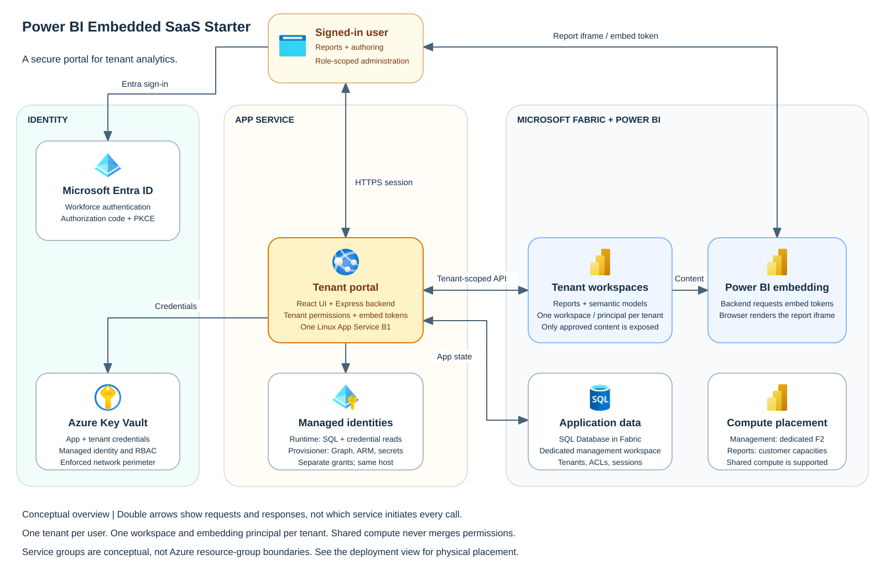
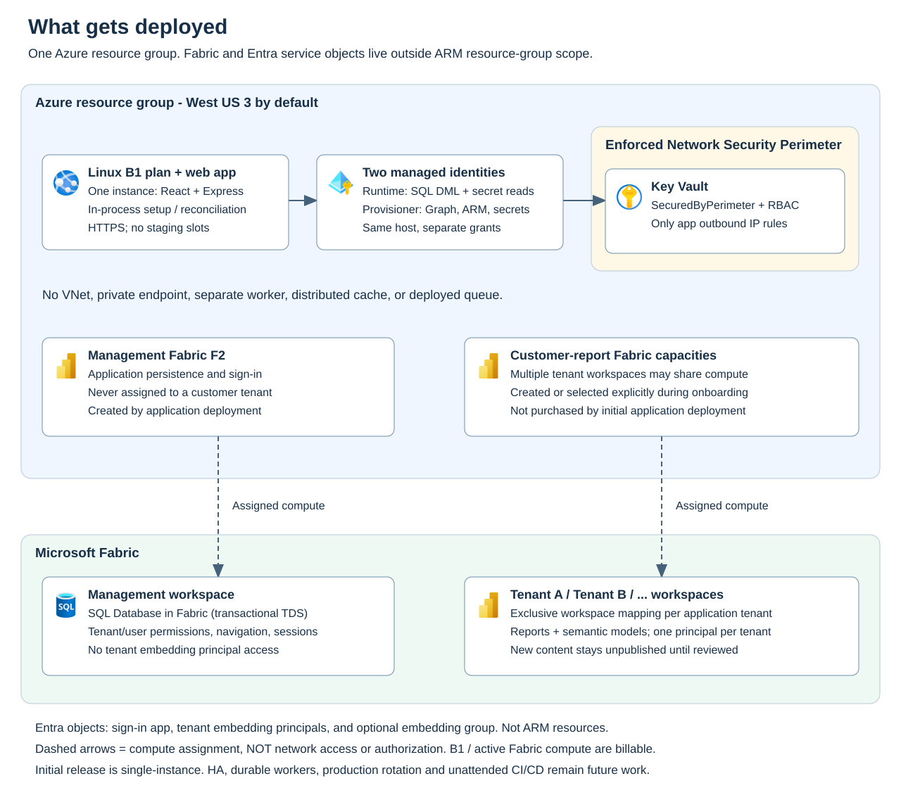

# Power BI Embedded SaaS Starter: Architecture

This document describes what the tenant portal does, how its components and
security boundaries work, and how to deploy and operate it. The
[README](README.md) provides the full setup instructions.

## Solution overview

The solution is an npm-workspace application: React/TypeScript frontend and
Express/TypeScript backend, hosted together behind one origin. It uses
App Owns Data embedding, Microsoft Entra sign-in, server-side SQL sessions,
and SQL Database in Fabric as its system of record.

The Fabric SQL database stores **application metadata**: tenants and their
workspace/embedding-identity mappings, registered users and tenant membership,
platform/tenant administrator roles, user permission defaults and item grants,
report/model inventory and publication status, and the shared navigation
hierarchy. It also stores audit records, encrypted sessions, application settings
and tenant-provisioning checkpoints. Roles are administrator flags and permission
bits, not configurable role definitions.

This management database is not the analytical data store for embedded reports:
report definitions, semantic models and their analytical data remain in Fabric/
Power BI and the models' configured data sources. Production client credentials
and the session-encryption key live in Key Vault; SQL holds credential references
and encrypted session/token-cache data rather than plaintext client secrets.

Platform administrators provision tenant workspaces, manage customer capacity,
and appoint tenant administrators. Tenant administrators register users, approve
reports/models, and manage shared navigation and inherited permissions. Authorized
users view, edit, copy, or create reports within their assigned tenant workspace.
Each tenant has a dedicated embedding identity; users belong to one application
tenant and cannot select another tenant's workspace for embedding.

For demos, new-tenant setup offers an optional **Include sample** checkbox. The
backend imports the bundled Store Sales PBIX into that tenant's workspace,
registers its report/model and navigation metadata in SQL, and publishes just
those sample artifacts for users with the required permissions.
Tenant administrators can also choose **Add sample report** later in their
own-tenant console, without changing capacity, workspace, identities or grants.

## Logical topology



The conceptual view places the signed-in user above the highlighted application,
tenant analytics to the right, and supporting identities/data below. It groups
services by responsibility, not by Azure resource-group membership. Double
arrows show requests/responses; the content arrow shows the reports/models used
for embedding, not a second deployed data pipeline.
SQL and Key Vault are backend dependencies, never browser services.
One shared application process remains a trust boundary across tenants, despite
separate tenant embedding identities.

### Deployment layout



The first diagram explains **how the solution fits together**; this one explains **what is
deployed and where compute is assigned**. Dashed arrows mean capacity assignment,
not requests, network access, or authorization.

Both views are pages in the [editable draw.io file](docs/architecture.drawio).
They and the SVG previews are generated from
`scripts\Export-Architecture.mjs` using
`node .\scripts\Export-Architecture.mjs`. Icons are embedded for offline use;
[attribution](docs/icons/NOTICE.md) accompanies the unmodified artwork.

### Resource boundaries

| Boundary | Contents and responsibility |
| --- | --- |
| Azure resource group | One Linux B1 plan/web app, two user-assigned managed identities, Key Vault/NSP, dedicated management F2, and any separately purchased customer Fabric capacities |
| Management Fabric workspace | Transactional SQL Database holding application state; never a customer tenant |
| Tenant Fabric workspace | One exclusive workspace per application tenant; reports/models and a dedicated embedding principal |
| Microsoft Entra directory | Sign-in application, tenant applications/service principals, optional embedding security group, and directory users |
| Power BI service | Issues backend-requested embed tokens and renders analytics in the browser iframe |

Fabric capacities are ARM resources. Fabric workspaces, SQL items, reports and
models are service objects, not ARM resource-group children; Entra objects are
also outside that group. Multiple tenant workspaces may share a customer capacity.
Compute placement is not a tenant authorization boundary.

The new-environment default is **West US 3 (`westus3`)**. Existing external configurations
remain pinned to their own region/subscription/IDs; changing defaults never moves
resources. No queue, separate worker host, distributed cache, VNet, private
endpoint, VPN, gateway, or central telemetry service is deployed.

## Assumptions and dependencies

### Design assumptions

| Assumption | Architectural consequence |
| --- | --- |
| Customer workspaces live in the operator's Fabric environment | An application tenant is a logical customer boundary, not a separate Entra/Fabric directory; cross-directory customer hosting is not implemented. |
| Users already exist in the configured Entra workforce directory | Registration links directory identities to application records; it does not create accounts, send invitations or enable consumer/federated sign-in. |
| Ordinary users belong to one application tenant | The backend derives the workspace from SQL membership; there is no user-selectable tenant switching. Platform-only administrators may have no tenant. |
| Each tenant has one exclusive workspace and embedding principal | Customer capacity may be shared, but workspace membership, application metadata and token scope remain isolated. |
| Models have working data connections and supported security/dependencies | Data-source credentials, refresh setup, gateways and model networking are managed outside the portal. Required effective-identity RLS and unsupported model dependencies block embedding. |
| Customer content is deployed through external Power BI/Fabric tools | The portal discovers, reviews and authorizes content. Setup and tenant administration can add a fixed bundled demo PBIX; general-purpose uploads and model deployment are not implemented. |
| Hosting is a single App Service instance | Background work and startup coordination run in-process; interrupted tenant provisioning requires operator retry, and scale-out requires additional coordination. |

### External and runtime dependencies

| Dependency | Required capability or operational effect |
| --- | --- |
| Azure subscription, regional availability and organizational policy | Permit B1 App Service, management F2, Key Vault/NSP, managed identities, resource providers and required role assignments. Customer report capacity is provisioned separately. |
| Microsoft Entra ID and Microsoft Graph | Provide workforce sign-in, application/service-principal creation, exact user lookup and optional security-group membership. Deployment requires appropriate directory consent and operator privileges. |
| Fabric and Power BI tenant settings and APIs | Permit the intended service principals to use APIs and embed content; an authorized Fabric administrator manages global settings and any allowed security group. |
| Fabric capacities and transactional SQL Database | Management capacity supports metadata reads/writes, SQL-backed sessions and sign-in; tenant capacity supports report use. Pausing management compute interrupts application access unless explicitly enabled recovery resumes it. |
| Azure Key Vault, managed identity and NSP | Supply production credentials and the session key. Both identity/RBAC and allowed application egress are required; network access alone does not grant secret access. |
| Service connectivity | The backend must reach Entra/Graph, ARM, Fabric/Power BI APIs, the Fabric SQL TDS endpoint and Key Vault; the browser must reach the portal, Entra sign-in and Power BI embedding services. |
| Power BI/Fabric licensing and publishing rights | Capacity must support the intended embedding workload. People publishing directly to Fabric need separately assigned service permissions and applicable licenses; application roles do not supply them. |
| Application toolchain | Node.js 22 LTS/npm run and build the React/Express application; PowerShell 7 and an authenticated Azure CLI drive setup/deployment. The browser uses the Power BI JavaScript SDK for embedded interaction. |

Detailed identity grants, network controls, capacity recovery and deployment
procedures are described in the corresponding sections below.

## Accepted decisions

| Decision | Rationale and invariant |
| --- | --- |
| React + Express/TypeScript | Separate frontend/backend responsibilities, with one same-origin deployment; no ASP.NET dependency |
| App Owns Data only | Generate all view/edit/create/copy tokens on the backend; user management tokens never become embedding credentials |
| SQL Database in Fabric | Relational constraints, transactions, hierarchical ACLs, encrypted sessions and operation state; not Cosmos, SQLite, Azure SQL hosting, Warehouse or a SQL analytics endpoint |
| One tenant per ordinary user | Resolve membership from trusted SQL records, not client-selected tenant/workspace IDs |
| Separate administration scopes | Platform administration manages infrastructure and appointments, not customer content access |
| Dedicated management compute | Keep application persistence/sign-in separate from customer report capacity |
| One Linux B1 instance | Lightweight initial target; in-process work, in-place updates, no slots or HA guarantee |
| Key Vault + enforced NSP | Production secrets stay in Azure, with managed identity/RBAC and explicit app egress rules; no unprotected-public fallback |
| Dedicated tenant principals | Each tenant principal is granted only its assigned workspace; profiles/federated credentials are not implemented |
| Shared navigation with inherited grants | One canonical security parent per item; aliases do not change Power BI artifact names |

## Code and component map

| Component | Canonical implementation |
| --- | --- |
| HTTP routes, sessions, bootstrap and admin boundaries | `src\server\src\app.ts` |
| Entra authorization-code flow and encrypted session store | `auth.ts` |
| Azure identities, credential access, Graph and ARM calls | `azure.ts`, `local-secrets.ts`, `deployment-secrets.ts` |
| Tenant/item authorization and token shape | `domain.ts`, `fabric.ts` |
| Versioned SQL and repository operations | `db.ts`, `migrations.ts`, `repository.ts` |
| Guided setup with SQL checkpoints/leases | `provisioning.ts` |
| Fixed demo PBIX asset and tenant-scoped import | `sample.ts`, `fabric.ts`, `samples\Store Sales.pbix` |
| In-process reconciliation and failure-driven recovery | `background.ts`, `capacity-recovery.ts` |
| Report viewer/authoring and lifecycle guards | `src\web\src\reports.tsx`, `embedding.ts` |
| Platform and own-tenant admin UI | `platform.tsx`, `main.tsx` |

## Authentication and service identities

### User sign-in and sessions

The confidential Entra application uses MSAL Node authorization-code redemption,
PKCE, state and nonce checks against the configured workforce directory.
The stable membership key is `(DirectoryId, ObjectId)`, not email.
Successful sign-in alone never creates application membership.

The browser holds an HttpOnly application-session cookie and sends a CSRF header
for mutations. Production cookies require HTTPS. The delegated Power BI
management token cache stays in an AES-GCM-encrypted SQL session; the session
key comes from the configured credential store. Session regeneration occurs at
sign-in. No access tokens or client credentials are persisted in browser storage.

Delegated tokens are used only for authorized workspace administration, discovery,
capacity assignment and similar management calls. Future consumer/federated
identity must preserve the same internal authorization model and deliberate
account linking; matching email addresses must not merge identities.

### Service identity responsibilities

| Identity | Current access |
| --- | --- |
| Deployment operator | Signed-in workforce user provisioning ARM/Entra/Fabric and applying SQL migrations/grants |
| Runtime managed identity | Key Vault Secrets User, management workspace Viewer plus SQL DML on the `app` schema |
| Provisioning managed identity | Key Vault Secrets Officer, Graph app ownership/creation and user lookup, optional embedding-group membership, RG-scoped Fabric capacity operator |
| Tenant embedding principal | Credential in the selected store; workspace Admin on only that tenant's workspace; Power BI token generation |

Graph application grants are `Application.ReadWrite.OwnedBy`, `User.Read.All`,
and optionally `GroupMember.ReadWrite.All`. The provisioner owns the sign-in app
for Azure-side credential initialization. The custom ARM role currently permits
`Microsoft.Fabric/capacities/*` only in the configured resource group.
Management-workspace Viewer is necessary for Fabric item connection permission
and also includes workspace data/OneLake read access; keep that workspace
management-only. SQL user SIDs use managed-identity **client IDs**, while Fabric
role assignments use principal **object IDs**.

Distinct managed identities share the same App Service process: they separate
grants, not process isolation. A compromised shared backend could access multiple
tenant credentials. No tenant principal receives management-workspace access.

## Administrator operating model

Platform administration owns the **tenant infrastructure and onboarding control
plane**; tenant administration owns the **application user/content experience
inside one tenant**. These application roles do not confer Entra directory,
Azure RBAC, direct Fabric publishing permissions or report-access bypasses.

| Scope | Platform admin | Tenant admin |
| --- | --- | --- |
| Tenant/capacity lifecycle and embedding identity setup | Owns | Not permitted |
| Primary/additional tenant-admin appointment and revocation | Owns | Cannot promote users |
| Ordinary tenant membership and user/item permission grants | No authority from platform status alone | Own tenant only |
| Content synchronization/publication and shared navigation | No authority from platform status alone | Own tenant only |
| Report viewing/authoring | Requires tenant membership and effective item/model grants | Requires effective item/model grants |

See the [administrator guide](docs/administration.md) for the human responsibilities,
actual resource-creation sequence, administrator handoff/changes, and user/content
operating procedures. Guided creation grants Fabric workspace Admin to the
**tenant service principal**, not automatically to the **human tenant admin**.
Content lifecycle has separate external Fabric deployment, portal discovery,
portal approval and user-authorization steps.

## Tenant isolation and authorization

An application tenant is not an Entra directory, workspace, or capacity.
Every tenant has at most one assigned workspace and every registered workspace
maps exclusively to one tenant. Pending tenants may exist without a workspace.

Ordinary users have exactly one tenant. A platform-only admin may have no tenant
only with tenant-admin status and default tenant permissions cleared. A dual-role
admin still has at most one tenant. Membership reassignment is not implemented.
SQL constraints and backend checks reject cross-tenant associations.

Platform admins create/adopt tenants, manage infrastructure/capacities, and appoint
tenant admins. They cannot use platform status to read reports, edit navigation,
manage tenant users, or bypass embedding authorization. Tenant admins manage
only their own tenant and cannot set administrative role flags through user APIs.

Platform appointment accepts an exact UPN or manual object-ID/display-name pair.
Tenant-user registration uses the same server-side exact-UPN resolver, after
own-tenant admin authorization. Graph selects only identity fields, escapes
OData keys/guest UPNs, validates the exact returned UPN and GUID, and never resolves
email aliases by taking the first search result. Manual IDs remain available
when lookup is unavailable. Neither path creates a directory account/invitation.

### Current permission model

| Permission | Bit | Meaning |
| --- | --- | --- |
| `ViewReport` | 1 | View an authorized published report |
| `EditReport` | 2 | Edit an authorized report, with model-authoring permission |
| `CreateReport` | 4 | Create reports in the tenant workspace |
| `CopyReport` | 8 | Save As, subject to source/edit/create checks |
| `UseSemanticModelForAuthoring` | 16 | Use a published tenant model for authoring |
| `ManageContent` | 32 | Content-management capability; portal uploads are deferred |
| `ManageNavigation` | 64 | Manage navigation labels/structure where authorized |

These are ACL bits, not configurable role definitions. Tenant-admin membership/
permission management and platform management use separate role flags.
Additional tenant-admin appointments grant no report permissions and preserve
existing defaults/grants. Guided creation explicitly gives a **new tenant's
initial admin** all seven default bits (127), as ordinary inherited grants,
not an ACL bypass. Retries must not overwrite subsequent permission edits.
Primary-admin replacement removes only the former primary's admin flag,
preserving membership, defaults, grants, and additional administrators.

### Navigation and publication

Flat navigation means report nodes directly under a tenant root. Folders, order
and labels form one tenant-wide hierarchy, not personalized layouts. Viewers see
only permitted reports and their nonempty ancestor branches.

Effective grants combine user defaults and canonical ancestor/node grants until
an inheritance break. Default is deny; there is no explicit-deny precedence.
Moves reject cycles and cross-tenant parents. Moving/breaking inheritance may
change access; the current UI warns rather than computing an effective-access diff.
Navigation aliases are independent of Fabric report names.

Newly discovered reports/models remain **unpublished**, even when broad root
grants exist. Tenant admins review publication independently of user permissions.
The opted-in bundled sample is the narrow exception: setup or the tenant-admin
sample action publishes only the report/model IDs returned by its own import,
after checking dependencies/security.
Role flags alone do not authorize report rendering. Direct permissions users
already hold in Fabric are outside the application's ACL enforcement.

## Backend embed-token contract

1. Authenticate the application session and reload the user/sole tenant.
2. Resolve requested item IDs through tenant-owned SQL records and check effective
   report/model permissions and publication state.
3. Read the actual report/model dependency from Power BI using that tenant's
   principal. Reject rebound, cross-workspace, missing, RLS-required, or unsupported
   chained/composite dependencies.
4. Generate the narrow token for only the authorized items/operation and return
   its expiry and embedding configuration to the browser.
5. Reauthorize renewal, saves requiring a new token, and copy/create operations.

View/edit tokens contain no target-workspace entitlement. Copy/create tokens
include only the server-resolved tenant destination; the browser cannot override
workspace or tenant context. Model authoring is checked independently of report
editing. Existing tokens may remain usable until expiry after a permission change;
the acceptable revocation window still needs production definition.

Effective-username RLS is future work. Trusted tenant/model identity and role
mappings must be resolved on the backend when implemented. For now, required
effective identities **fail closed**, never retrying without RLS. RLS would
supplement tenant/item isolation, not replace it.

### Report UX and lifecycle

Reports use standard SDK `embed`, not phased `load`/manual `render`.
Existing reports enable interaction on `rendered`; new reports use `createReport`
and become ready on `loaded`. Named SDK permission enum values are used rather
than treating them like the application ACL bitmask.

Compact chrome and an anchored, keyboard-accessible Reports popover leave canvas
space available. Full-screen-style Focus is explicit/default-off and resizes the
same iframe. Focus, Save As and token updates preserve unsaved edits.
Model selection precedes new-report creation; Save As uses the backend destination.
SDK `saved` confirmation triggers inventory reconciliation; new/copy sessions
close so unpublished content is not left open. Confirmation timeouts do not claim
success or blindly retry. Switching reports/views or leaving an editor warns
before discarding work. Cleanup invalidates old callbacks and renewal timers.
Sanitized SDK messages must never dump token-bearing configuration.

## Persistence and reconciliation

The shared transactional Fabric SQL database holds application metadata and
operational state under schema `app`, separate from tenant analytical content.
The tables are:

| Table | Stored state |
| --- | --- |
| `SchemaVersions` | Applied migration versions (currently 1-3) |
| `Tenants` | Workspace mapping, embedding-identity references, lifecycle/readiness, primary administrator |
| `Users` | Stable directory identity, sole tenant, admin flags, root permission defaults |
| `Content` | Reports/models, external IDs, report-model dependency, publication/deletion/security flags |
| `Nodes` | Canonical navigation/security hierarchy, labels, order and inheritance breaks |
| `Grants` | User/item permission masks scoped to a tenant |
| `Settings` | Bootstrap completion and verified workspace-capacity bindings |
| `Audit` | Safe actor/action/resource/outcome records |
| `Sessions` | Encrypted server-side session and token-cache data with expiry |
| `ProvisioningOperations` | Idempotent setup/sample requests, progress, checkpoints, lease and outcome |

Migrations run under a SQL application lock. Version 2 preserves existing users
while allowing platform-only admins; version 3 adds setup operations and primary
admin metadata. Tenant-aware constraints, exclusive workspace/root/content
indexes, and transactions protect associations. No invitation, external-identity,
custom-role, outbox, or separate dependency-graph tables are implemented.

The in-process five-minute reconciler inventories only registered workspaces
with configured tenant identities; tenant admins can synchronize explicitly.
New items get unpublished content/security nodes. Existing aliases/grants survive
backing-item renames; deletions/dependencies are recorded. Invalid/incomplete
responses do not intentionally become successful empty inventories.
Embed requests independently recheck live dependencies.

Power BI report/model discovery must not depend on unsupported Fabric item events.
Distributed reconciliation, transactional outbox dispatch, comprehensive inventory
pagination/throttling hardening and production-scale scheduling remain future work.

## Bootstrap and tenant provisioning

Deployment, initial platform bootstrap and customer onboarding are independent.
Bootstrap checks deployment-controlled directory/object ID and transactionally
creates a platform-only admin plus persisted completion. It does not require
workspace adoption/creation or a successful report token. Restarting or a failed
SQL read never reopens enrollment.

### Guided creation and settings

The platform form collects workspace name, primary-admin exact UPN and either an
active existing capacity or an explicitly approved new SKU. The backend:

1. Checks authorization/membership and creates the pending tenant/root plus
   an idempotent SQL operation.
2. Creates/reuses the tenant Entra application, service principal, credential
   and optional embedding-group membership.
3. Reuses an active customer capacity, or creates one with billing approval and
   waits for both ARM and Fabric visibility.
4. Creates/reuses the workspace and persists its exclusive tenant mapping.
5. Grants the intended tenant service principal workspace Admin, assigns capacity,
   and waits for observed assignment.
6. Appoints the initial/replacement human administrator atomically in application
   SQL; this does not automatically grant them a human Fabric workspace role.
7. Verifies actual tenant-principal workspace access.
8. If **Include sample** was selected for a new tenant, imports and publishes the
   bundled report/model and synchronizes their metadata before completing setup.

Readiness establishes infrastructure/runtime access, not arbitrary content
deployment, publication or end-user report grants. Without sample seeding, a
ready empty tenant is valid.
The platform admin hands off content/user operations to the appointed tenant
admin, who uses the workflow in [the administrator guide](docs/administration.md#tenant-admin-run-the-tenant-experience).

Settings edits reuse tenant/workspace/identity IDs; rename/capacity changes do
not recreate the workspace or discard content/ACLs. Additional administrator
appointments remain independent. Data-source/gateway settings are excluded.

Setup workers run in-process with 90-second SQL leases, 20-second lease-only
heartbeats, and a unique running-operation-per-tenant index. Completed steps pin
external IDs. Tokens remain in worker memory, not persisted operation state.
After interruption, the original operator must explicitly retry with a fresh
delegated token after lease expiry; this is **not** an unattended durable queue.
Heartbeats cannot revert completed state. Ambiguous app/workspace creation
without a pinned ID requires manual reconciliation; neither retry nor a new
request may blindly recreate it. Failed resources are not automatically deleted.

### Optional demo sample seeding

`samples\Store Sales.pbix` is a backend asset included in source control and the
Azure deployment ZIP, not the public frontend directory. The setup request
accepts only an optional `includeSample` boolean, defaulting to off; it accepts
no client file path, upload URL or destination workspace. Existing-tenant settings
and workspace adoption do not seed implicitly; a tenant admin can request the
sample separately once their tenant is ready.

The tenant-admin **Add sample report** action uses tenant-scoped sample
status/add/retry endpoints under `/api/tenants/:id/sample`. The backend requires
the current own-tenant admin role and derives the destination from membership;
platform status alone is insufficient. Standalone sample operations use the
same SQL operation table/leases, with `kind: sample` and a pinned workspace ID.
They run only the sample step, with the tenant service principal and no delegated
operator token, Graph/ARM provisioning, admin appointments or permission changes.
The worker rechecks the initiating admin's role and workspace before importing
and publishing. The original admin can retry while still authorized.

A per-tenant SQL transaction and the running-operation constraint coordinate
sample requests with setup. Both initial seeding and manual addition are
recognized, so repeated requests reopen the existing operation instead of
importing a second copy or republishing content edited/unpublished afterward.
Standalone sample failures do not change tenant readiness or block other reports.
Tenant sample endpoints cannot retry platform setup operations.
An initial setup failure is not treated as an existing sample when its sample
step never started, no upload/checkpoint or recovery uncertainty exists, and the
latest tenant setup subsequently succeeded. This allows a separate tenant-admin
sample request without changing the historical failure. Attempted, accepted,
completed and ambiguous imports continue to block a second import.
The superseded initial request cannot be retried through the platform endpoint
to bypass this rule or replay old infrastructure settings.

After administrator appointment and runtime verification, the worker uses that
tenant's service principal to submit a multipart Power BI import into its
server-resolved workspace. `nameConflict=Abort` prevents overwriting existing
content. The operation checkpoints the upload intent and returned import ID,
then polls that import to completion. The bundled PBIX is limited to 64 MiB by
the application; this is not a general large-file import facility.

Normal inventory synchronization creates/updates the tenant's `Content` and
`Nodes` records. The worker verifies that the returned report belongs to the
returned model and neither has unsupported dependencies/security, then publishes
only that pair. Publication and its completion checkpoint commit in one SQL
transaction; retries do not republish a sample subsequently unpublished by a
tenant admin. No user grants are changed by seeding. The new tenant's initial
admin can use the sample through their existing full root defaults; other users
still need permission grants.

Pending imports and metadata failures retry using the saved import ID, not a
second upload. An unknown upload outcome without a saved ID, or a terminal
Power BI import failure, requires manual workspace/import-history reconciliation.
The worker never blindly overwrites, deletes or reimports artifacts. Other
discovered content remains unpublished. Data-source/refresh configuration is
still external to the portal.

### Adoption and readiness

Discovery lists workspaces visible to the authorized operator, not necessarily
the whole Fabric tenant. Adoption requires verifiable direct workspace Admin
access; group-derived Admin support is incomplete. It registers an exclusive
mapping without implicitly granting membership, copying artifacts, changing
data sources, assigning capacity, or publishing content.

A tenant can be registered while missing capacity/runtime access. Keep it
administratively manageable but block content use until required checks pass.
Readiness records workspace/capacity visibility, capacity state and actual
tenant-principal workspace access with timestamps and pass/fail/unknown results.
An operator's visibility does not prove runtime access; a generic 403 is not
proof that a workspace role alone is missing. Empty content is not itself a
configuration failure. Repairs are explicit, authorized and rechecked; never
substitute the operator's token for embedding.

## Capacity management

ARM manages capacity create/resize/pause/resume/delete; Fabric/Power BI APIs
assign workspaces. Multiple tenant workspaces can share a capacity without
reserving it or changing other assignments. **Platform admin > Fleet Management**
automatically loads tenant configuration status, ARM state and registered capacity
associations. Its tenant rows offer pause/resume and links to separate
**Tenant Details**; an expandable resource inventory retains resize/delete.
**Add Tenant** is a separate guided provisioning/adoption screen, which hands off
accepted operations to tenant details for durable progress. Details show
configuration/admin controls, identity/workspace facts and explicit saved-state
readiness checks, without fleet-wide capacity controls. Platform navigation uses
hash URLs for browser back/forward and direct tenant links; the same guarded
backend APIs remain authoritative.
Failed tenant findings expose narrow repair APIs: current-assignment-verified
customer capacity resume and confirmed configured-principal workspace access
repair. Both require platform authorization, CSRF and audit, and are blocked
during running setup. Membership is inspected before choosing Add (POST) or
Update (PUT); already-correct Admin membership is skipped. Accepted resumes
are observed before rechecking readiness, without write replay. Replacement
capacity choices use durable guided setup rather than a second creation path.
Unknown credentials/group/tenant-policy failures remain explicit manual findings.
Individual pause/resume/resize controls check
stable resource state and skip already-satisfied requests. Resize preserves
workspace assignments, tenant content and permissions.

`capacity-management.ts` combines scoped, paginated ARM inventory with SQL tenant
mappings and current delegated Power BI workspace/capacity discovery. It requires
a unique Fabric-to-ARM match; persisted auto-resume bindings are not the bulk
selection authority. **Pause all tenant capacities** and **Resume all tenant
capacities** include distinct currently assigned customer resources only, within
the configured subscription/resource group. Management and unassigned resources
are excluded, known out-of-scope tenant capacities are reported, and unverifiable
assignments block bulk submission. The browser confirms the exact resource set;
the backend rejects stale selections and rechecks assignments before each change.

Bulk changes are sequential, audit each result, skip resources already in the
desired state and continue after individual failures. SQL/audit failure stops
further requests. There is no rollback or durable capacity-operation queue;
interrupted backend requests can leave partially submitted work. Azure acceptance
is distinct from completion. The browser polls each accepted resource every five
seconds for up to 15 minutes, reports failures/unconfirmed outcomes, and stops
observation on unmount. Refresh Azure state before a deliberate retry; submitted
capacity writes are never automatically replayed.

Management workspace/capacity IDs are externally pinned. They are excluded from
adoption, tenant assignment, in-app customer capacity mutation and embedding,
even if tenant records are misconfigured. Tenant principals never access them.
Capacity deletion blocks known registered-workspace assignments but cannot prove
the absence of unmanaged consumers. Shared-capacity changes affect every assigned
tenant; full impact/decommissioning workflows and load-based sizing remain work.
Resume restarts compute billing. Enabled automatic resume can wake a manually
paused tenant capacity; pausing does not create a persistent no-resume policy.

### Capacity recovery

`AutoResumeCapacities` is the initial billing opt-in, default `false`;
`-EnableCapacityAutoResume` enables the deployment default and reruns preserve it.
Platform admins can inspect, enable or disable the effective policy in
**Fleet Management > Automatic capacity resume**. The disabled state prompts
for an explicit opt-in; enabling requires billing confirmation. This is an
application policy, not a Fabric resource property.

`capacity-policy.ts` persists a versioned boolean/revision record under
`capacity-auto-resume-policy` in the existing Key Vault/development credential
store, not SQL. A saved policy overrides deployment configuration across
restarts. The runtime loads it before database/session access and refreshes it
on foreground demand with a one-minute cache; admin reads force refresh.
Only a genuine missing record falls back to the deployment default. Denied,
invalid, disabled or expired records disable recovery and produce a platform
warning. Existing credential-store reader/writer grants are reused; no broader
App Service ARM write role is needed.

Admin updates require platform authority, CSRF, current revision and billing
confirmation, with global audit intent/completion. In-process serialization
prevents stale reads/writes from restoring an old policy; uncertain writes are
read back without replay. This targets the maintained single-instance deployment,
not a cross-instance compare-and-swap protocol. Turning the policy off does not
pause resources or cancel already submitted Azure work. If SQL is already
unavailable with recovery disabled, an Azure operator must restore compute before
using the console; a saved disabled policy remains authoritative over an env flag.
There is no successful-path capacity preflight or daily schedule.

On a relevant foreground SQL connection/read failure, recovery checks the
external `ManagementCapacityResourceId`, resumes only confirmed paused/suspended
resources and waits for Active/data readiness. Generic SQL authorization errors
or an already-active/disabled/unknown resource are not reasons to blindly restart.
Because SQL-backed sessions cannot authenticate while compute is paused,
**reachable anonymous foreground requests may restart management billing**.
Use external authentication/network restrictions if that policy is inappropriate.
Static files, health probes and background reconciliation never wake capacity.

Tenant recovery requires effective item/model authorization, a persisted
`WorkspaceCapacity:<workspaceId>` binding in `Settings`, and current workspace
assignment revalidation. Admin settings/guided assignment refresh the unique
Fabric-to-ARM mapping in the configured subscription/resource group.
Stale, ambiguous or out-of-scope mappings fail closed; no browser-selected ARM
resource is trusted. Authorization is reloaded after startup.

Resume is single-flight per resource within one process, with bounded polling
and cooldown, not a distributed lock. Retry only safe reads/connections/token
generation or one initial still-inert iframe. Never replay submitted writes,
transactions, provisioning requests, saves or an interactive editor.

## Deployment and secret handling

The maintained entry point is `scripts\Deploy.ps1`. Local development uses
`Initialize-Local.ps1` and `Start-Local.ps1`; direct Fabric setup is in
`Initialize-FabricDatabase.ps1`. Commands and prerequisite grants are in the README.
All use externally stored configuration; `Common.ps1` owns naming and guards.

### Prerequisites and deployment command

Use PowerShell 7, Node.js 22 LTS/npm, and Azure CLI from the repository root.
The deployment operator needs an authenticated Entra workforce account with
Azure resource/provider, custom-role/role-assignment, Entra app-registration,
and Fabric capacity/workspace/SQL provisioning permissions. An authorized Entra
administrator must grant the required Graph application permissions and delegated
Power BI consent. Fabric tenant settings must allow the intended service
principals to use APIs and embed content.

For a new environment, select a unique namespace and an external configuration
path. Deployment creates billable B1/F2 resources; local initialization is not
required first.

```powershell
az login --tenant "<directory-id>"
az account set --subscription "<subscription-id>"

$deployment = @{
    NamePrefix = 'demoweb'
    Location = 'westus3'
    ManagementCapacitySku = 'F2'
    AppServiceSku = 'B1'
    ConfigurationPath = Join-Path $env:LOCALAPPDATA 'PBIEmbeddedAOD\demoweb-pbiembedded\configuration.json'
}

# Add ServicePrincipalGroupId if Fabric tenant settings require an existing group.
.\scripts\Deploy.ps1 @deployment -WhatIf

# After approving the resources, permissions, and costs:
.\scripts\Deploy.ps1 @deployment -GrantGraphPermissions -GrantAdminConsent -Confirm:$false
```

The grant switches require an already authorized operator; they do not elevate
permissions. Reuse the same configuration path and namespace for reruns.
See [setup prerequisites](README.md#prerequisites) and
[Azure deployment](README.md#deploy-to-azure) for group configuration, health
checks, failure handling and costs. After deployment, follow
[first sign-in and tenant onboarding](README.md#first-sign-in-and-tenant-onboarding)
to bootstrap platform administration and provision customer tenants.

### Configuration and naming

Names are derived from `<prefix>-<solution>` (solution `pbiembedded`), limited to
21 characters and never silently truncated/randomized. Fabric capacity names
remove hyphens. Naming version 2, provider, resolved names, region, subscription
and management IDs pin reruns; incompatible values require a deliberate
migration/new namespace. Fabric returns the actual SQL TDS endpoint/catalog;
its companion `SQLEndpoint` item is not the transactional database.

### Deployment sequence

1. Validate tools, locked dependencies, type checks, builds/tests and production
   dependency portability.
2. Check regional/SKU counters, create/reuse the non-billable resource group and
   validate the exact Linux plan with ARM **Provider** validation.
3. Provision/reuse management F2/workspace/SQL, sign-in app, vault/NSP, identities,
   explicit grants/consent, and B1 plan/web app.
4. Apply migrations with the deployer's SQL identity and grant runtime DML;
   configure non-secret settings, actual returned HTTPS hostname/callback and
   startup command.
5. Package only manifests, compiled frontend/backend, the bundled sample PBIX
   and locked Linux/x64 production dependencies; synchronously ZIP-deploy, then require liveness
   and readiness before reporting success.

Quota counters/catalog entries do not guarantee provisioning availability;
an omitted SKU row may defer to mandatory Provider validation, but exhausted or
missing/ambiguous total regional counters fail closed. Validation does not reserve
capacity. No fallback SKU/region or automatic management-capacity resume is allowed.
The full current script is workforce-user driven; service-principal/OIDC CI
authentication is not implemented.

Windows `az.cmd` can strip inline JSON quotes, so health-check configuration uses
`healthCheckPath=/health/ready`. ZIP deployment uses
`--async false --track-status false`: wait for artifact deployment, then use
explicit HTTP probes rather than unreliable CLI Linux startup tracking.

### Azure-only credential initialization

Infrastructure setup uses `-DeferSecrets`; the local deployment process neither
generates production secrets nor reads/writes the vault data plane.
Startup runs `--initialize-secrets <sign-in-app-object-id>` using the provisioning
managed identity, verifies app ownership/client identity, and writes a six-month
web credential and random session key directly to Key Vault. No HTTP initializer
endpoint, local secret payload, secret app setting or secret-bearing ZIP exists.

Healthy existing credentials are reused. Expired/disabled/unreadable credentials
fail closed rather than silently rotating. Only safe propagation reads retry;
password generation is not blindly repeated. Failed writes are checked before
revocation so an indeterminate committed write is not invalidated. An ambiguous
outcome can require operator recovery. Serialize deployment/startup on this
single-instance target; distributed initialization locking and explicit Azure-side
rotation remain unimplemented.

### Key Vault networking and access

The vault starts closed, receives an **Enforced** NSP association, then uses
`SecuredByPerimeter`, with settings verified by readback. The app is an external
perimeter client: only its current/possible outbound IPv4 `/32` prefixes are added
to the application rule. Obsolete script-managed deployment-source rules are
removed on rerun. No operator data-plane role or local-IP rule is required.

NSP rules and RBAC are independent; shared App Service egress is not an identity
boundary. The runtime uses the Key Vault SDK as Secrets User, the provisioner as
Secrets Officer. Organizational policy must permit this design. Never weaken
network controls, use exemption tags, bypass retention or claim that RBAC fixes
network denial. Plan/egress changes require deployment to refresh the rule.

### Local credentials and operations

Explicit `-UseLocalSecrets` stores plaintext named credentials under the external
configuration directory, protected by a current-user Windows DACL. Runtime rejects
repository paths, links into the checkout and local credentials in production/
App Service. There is no automatic file/vault fallback. Use one process per local
secret file, outside synced/shared folders. `-RotateWebSecret` is a local-setup
option, not a complete production rotation workflow; session-key rotation also
invalidates encrypted sessions.

Never write real secrets/tokens/private keys into source, ignored files,
configuration examples, frontend bundles, command-line outputs or logs.
Ignored paths are defense in depth, not permission to store secrets in the repo.
Use approved secret/advisory scanning before publishing or production use.

Reruns reuse IDs/healthy credentials; a failed deployment may leave billable
resources, and B1 updates may interrupt service. Code rollback requires a
known-good source/lockfile deployment; SQL rollback/recovery is separate.
Teardown must explicitly remove Fabric/Entra objects as well as ARM resources.
Purge-protected vault names remain retained for seven days.

## Limitations and future work

The single-instance design has no high-availability guarantee or durable job
queue. Operational extensions include centralized telemetry, rate limiting,
automated dependency/secret scanning, backup/restore procedures, complete
offboarding/retention, explicit production credential rotation, and an
unattended deployment identity/workflow.

**Deferred features:** general-purpose portal PBIX/model upload (beyond the fixed
bundled sample; future `ManageContent`-authorized
tenant-scoped backend import and reconciliation), effective-identity RLS,
paginated/chained/composite models, consumer/federated identity and deliberate
account linking, invitations, configurable role bundles, access-diff preview,
distributed workers/reconciliation/outbox and safe scale-out initialization.

**Out of scope:** model data-source connectivity/credentials, gateways, and
Fabric/model VNet design. Assume working semantic-model connections.
Do not silently expand this initial release into those areas.

Other open decisions are capacity pooling/service levels, export/direct-service
access policy, revocation latency, bootstrap recovery, group-derived adoption,
readiness freshness, supported upload formats, publication/versioning workflows,
and synchronization scale/throttling strategy. Recheck licensing/SKU eligibility:
App Owns Data consumers and direct human Fabric publishing have different
licensing requirements.

## Microsoft references

- [Service-principal multitenancy](https://learn.microsoft.com/en-us/power-bi/developer/embedded/multitenancy-service-principals)
- [Generate embed tokens](https://learn.microsoft.com/en-us/power-bi/developer/embedded/generate-embed-token)
- [Create and edit reports](https://learn.microsoft.com/en-us/javascript/api/overview/powerbi/create-edit-report-embed-view)
- [Import PBIX into a workspace](https://learn.microsoft.com/en-us/rest/api/power-bi/imports/post-import-in-group)
- [Observe an import](https://learn.microsoft.com/en-us/rest/api/power-bi/imports/get-import-in-group)
- [Embedded row-level security](https://learn.microsoft.com/en-us/power-bi/developer/embedded/embedded-row-level-security)
- [Capacity and licensing](https://learn.microsoft.com/en-us/power-bi/developer/embedded/embedded-capacity)
- [Fabric capacity management](https://learn.microsoft.com/en-us/rest/api/microsoftfabric/fabric-capacities?view=rest-microsoftfabric-2023-11-01)
- [Workspace capacity assignment](https://learn.microsoft.com/en-us/rest/api/fabric/core/workspaces/assign-to-capacity)
- [Fabric item-event exclusions](https://learn.microsoft.com/en-us/fabric/real-time-hub/create-streams-fabric-workspace-item-events)
- [Pause and resume capacities](https://learn.microsoft.com/en-us/fabric/enterprise/pause-resume)
- [External ID authentication options](https://learn.microsoft.com/en-us/entra/external-id/customers/concept-authentication-methods-customers)
