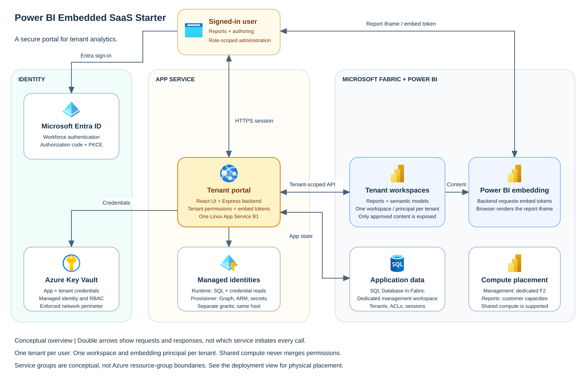

# Power BI Embedded SaaS Starter

A React/TypeScript frontend and Express/TypeScript backend for hosting Power BI
reports from Microsoft Fabric in a multitenant application. The backend owns
authorization, credentials, and embed-token generation; the browser never calls
privileged Fabric APIs directly.

## Capabilities

The application supports:

- Platform administration: create/adopt tenant workspaces, appoint tenant admins,
  optionally seed new tenants with a bundled sample report/model, and create,
  assign, resize, pause, resume, or delete customer Fabric capacities. Bulk pause
  and resume target only capacities currently assigned to registered tenants.
- Tenant administration: register existing Entra users, synchronize and publish
  content, add the bundled sample report, and manage shared navigation with
  inherited folder/report permissions.
- App Owns Data report viewing, editing, Save As, and creation from approved models.
  Each tenant has its own workspace and embedding service principal; ordinary
  users belong to exactly one application tenant.
- Initial report render history: authenticated user/tenant/report, request
  timestamp and request-to-first-render duration, including capacity startup.
  See [render history and administrator insights](ARCHITECTURE.md#report-render-history-and-administrator-insights).
- Metadata-backed Platform admin and Tenant admin insights pages. Platform
  insights show only tenant aggregates; tenant administrators can inspect their
  own users' request history and report performance without starting tenant capacity.
  Usage/performance use bar and line charts with rolling week/month/quarter/year
  presets and custom dates; only individual user request history remains a table.

[Setup](#setup) | [Azure deployment](#deploy-to-azure) |
[Tenant onboarding](#first-sign-in-and-tenant-onboarding) |
[Administrator guide](docs/administration.md) |
[Architecture and limitations](ARCHITECTURE.md)

## Architecture at a glance



One Linux App Service B1 instance serves both frontend and backend. Persistence
is a transactional **SQL Database in Fabric**, on a dedicated management F2
capacity. It stores tenant/workspace mappings, users and membership,
administrator roles, permission grants, content metadata, navigation, audit
records, initial-render history, encrypted sessions and provisioning state, not the reports' analytical
data. Production credentials live in Key Vault behind an enforced Network
Security Perimeter (NSP). Tenant report workspaces use separate customer capacity;
multiple tenant workspaces may share that compute without sharing permissions.

See the [resource layout](docs/architecture-deployment.svg),
[editable diagrams](docs/architecture.drawio), and
[detailed design](ARCHITECTURE.md), including
[assumptions and dependencies](ARCHITECTURE.md#assumptions-and-dependencies).

## Setup

Run commands from the repository root in **PowerShell 7**. Choose either local
development or Azure deployment; deploying does not require local initialization.

### Prerequisites

| Requirement | Local preview | Connected local / Azure |
| --- | --- | --- |
| Node.js 22 LTS and npm | Required | Required; Azure uses Node 22 LTS |
| PowerShell 7 and Azure CLI | Not needed for npm-only preview | Required by provisioning scripts |
| Azure subscription and Entra workforce account | Not needed | Required, with the permissions below |
| Fabric tenant and available regional capacity | Not needed | Required for management SQL and report hosting |

No .NET SDK, local SQL server, Cosmos DB, VNet, or gateway is required.
Local secret-file provisioning requires Windows for its current-user-only DACL.

For connected setup, the operator needs Azure resource/provider creation,
custom-role creation and role-assignment rights, Entra app-registration rights,
and Fabric capacity/workspace/SQL creation and SQL migration permissions.
**Azure Contributor alone cannot grant RBAC or directory consent.**
Production deployment additionally configures App Service, managed identities,
Key Vault, and NSP resources. Subscription policy and regional quota must allow them.

An authorized Entra administrator must grant the provisioning identity Graph
application permissions `Application.ReadWrite.OwnedBy` and `User.Read.All`;
`GroupMember.ReadWrite.All` is also required when an embedding group is configured.
The deployment can request those grants with `-GrantGraphPermissions`.
`-GrantAdminConsent` grants the sign-in app's delegated Power BI management scopes.
These switches do not elevate an unauthorized operator.

A Fabric administrator must allow the intended service principals to use Fabric/
Power BI APIs and embed content. If those tenant settings are restricted to a
security group, pass its existing ID with `-ServicePrincipalGroupId`; deployment
adds the runtime identity and later tenant provisioning adds tenant identities.
Scripts do not change global Fabric settings or bypass organizational policies.

### Preview without Azure

```powershell
npm ci
npm run build
npm start
```

Open `http://localhost:3000`. Without external configuration, this displays the
setup screen only: no fake sign-in, database, or authorization bypass is provided.
Stop the foreground server with `Ctrl+C` before starting another instance.

### Connected local development

This creates **billable management Fabric infrastructure**, but no App Service or
customer report workspace/capacity. Use a unique prefix for a new environment.
For an existing environment, reuse its original settings and configuration path.

```powershell
az login --tenant "<directory-id>"
az account set --subscription "<subscription-id>"
az account show --query "{subscription:name,subscriptionId:id}" --output json

npm ci
$local = @{
    NamePrefix = 'demo'
    Location = 'westus3'
    ManagementCapacitySku = 'F2'
    UseLocalSecrets = $true
    ConfigurationPath = Join-Path $env:LOCALAPPDATA 'PBIEmbeddedAOD\demo-pbiembedded\configuration.json'
}

# Preview; this neither provisions resources nor validates live permissions.
.\scripts\Initialize-Local.ps1 @local -WhatIf

# After approving the resources, permissions, and costs:
.\scripts\Initialize-Local.ps1 @local -GrantAdminConsent -Confirm:$false
.\scripts\Start-Local.ps1 -ConfigurationPath $local.ConfigurationPath
```

If Fabric tenant settings use an embedding group, add
`$local.ServicePrincipalGroupId = '<existing-group-id>'` before initialization.
`CreateServicePrincipalGroup = $true` is an alternative requiring directory
group-creation permission; a Fabric admin must still configure the tenant settings.

Initialization creates/reuses the dedicated F2, management workspace and SQL
Database, Entra sign-in app, and credentials. `Start-Local.ps1` builds, applies
versioned SQL migrations, and starts the same-origin application at
`http://localhost:3000`; it does not provision cloud infrastructure.

`UseLocalSecrets` explicitly selects **plaintext development-only credentials**
in `secrets\secrets.json` beside the external configuration. Windows permissions
restrict access to the current user. Keep this directory out of Git, shared/synced
folders, logs, and unprotected backups. Production rejects this credential store.
Omitting that switch selects Key Vault instead, which requires separately
approved local networking/RBAC; a role assignment does not bypass network rules.

## Deploy to Azure

Deployment uses a separate environment and Key Vault, not a local-file credential
configuration. Do **not** run local initialization first for this environment.
The default footprint is billable: **one Linux B1 plan/web app and a dedicated
management F2**, plus Key Vault/NSP and two managed identities.
All ARM resources target one resource group in **West US 3** by default.
Fabric workspaces/SQL items and Entra objects are outside ARM resource-group scope.
No customer report capacity is purchased during application deployment.

```powershell
az login --tenant "<directory-id>"
az account set --subscription "<subscription-id>"
az account show --query "{subscription:name,subscriptionId:id}" --output json

$deployment = @{
    NamePrefix = 'demoweb'
    Location = 'westus3'
    ManagementCapacitySku = 'F2'
    AppServiceSku = 'B1'
    ConfigurationPath = Join-Path $env:LOCALAPPDATA 'PBIEmbeddedAOD\demoweb-pbiembedded\configuration.json'
}

# When required by Fabric's existing group-scoped tenant settings:
# $deployment.ServicePrincipalGroupId = '<existing-group-id>'

.\scripts\Deploy.ps1 @deployment -WhatIf

# After approving the resources, grants, consent, and costs:
.\scripts\Deploy.ps1 @deployment -GrantGraphPermissions -GrantAdminConsent -Confirm:$false
```

**Run the final command directly in PowerShell for an uninterrupted script run.**
With Azure CLI already signed in under an authorized workforce account, all
decisions are supplied up front and there are no intermediate script questions.
Copilot command approvals are separate from PowerShell confirmation.
Fully unattended CI/CD with a dedicated deployment identity is not implemented.

The script:

1. Restores locked dependencies and runs type checks, builds, and tests.
2. Checks regional quota counters and validates the actual Linux plan with ARM
   Provider validation before creating billable infrastructure.
3. Creates/reuses management Fabric SQL, Entra configuration, Key Vault/enforced
   NSP, the B1 app, and distinct runtime/provisioning managed identities.
4. Applies SQL migrations/grants, configures the returned HTTPS hostname and
   callback, and synchronously deploys the compiled app and Linux dependencies.
5. Initializes missing production credentials **inside Azure**, then requires
   `/health/live` and `/health/ready` to pass before reporting success.

The local deployer does not generate production secrets or access the Key Vault
data plane. The provisioning managed identity writes credentials directly to the
vault at startup; healthy existing credentials/session keys are reused.
NSP permits the app's current/possible outbound IPv4 addresses with RBAC still
required. No local-IP allowance, unrestricted-public fallback, or VNet is used.

Keep deployment/startup initialization serialized on this single-instance target.
B1 has no staging slots; deployment can interrupt service. Regional usage
counters and SKU catalogs do not prove deployability: actual Provider validation
can reject an apparently available SKU, and validation is not a reservation.
Deployment never silently selects another SKU/region or resumes a paused
management capacity.

### Verify the running app

Use the **actual URL returned by deployment**, not a guessed hostname:

```powershell
$origin = 'https://<returned-app-hostname>'
(Invoke-RestMethod "$origin/health/live").status
(Invoke-RestMethod "$origin/health/ready").status
(Invoke-RestMethod "$origin/api/status").configured
```

Expect `live`, `ready`, and `True`. Readiness checks the migrated SQL schema and
both required Key Vault credentials under the runtime identity. It does not
prove that a customer report can be embedded.

### Reruns, failures, and costs

Reuse the same namespace, subscription, region, and external configuration path.
Resources and healthy credentials are reused; a rerun is not a data migration.
Deployment rejects `App__*` environment overrides and unsafe local-file-to-cloud
conversion. Resolve the reported error rather than deleting state or changing IDs.

Failed stages may leave billable resources. There is no destructive automatic
rollback. Pausing management F2 interrupts SQL sessions and sign-in; storage and
other charges may continue. Shared customer capacity operations affect all
assigned workspaces, not just the selected tenant.

Deleting a test environment requires explicit Fabric workspace/item and Entra
cleanup in addition to ARM resource-group deletion. Purge-protected vault names
remain reserved during seven-day retention; choose a fresh namespace or wait,
never bypass retention. No teardown script is included.

## Administrator responsibilities

| Role | Owns | Does not receive automatically |
| --- | --- | --- |
| **Platform admin** | Tenant creation/adoption, customer capacity, tenant service-principal/workspace setup, and tenant-admin appointments | Customer report access or tenant content/user management |
| **Tenant admin** | Their tenant's user registration, permission grants, content review/publication, folders and report labels | Platform/capacity control, authority to appoint admins, or external Fabric publishing rights |

Creating a tenant is a backend-orchestrated flow: validate/register setup,
prepare the tenant app/service principal and credential, prepare/select capacity,
create the workspace, grant the service principal access, assign capacity,
appoint the human admin, then verify readiness. The human admin's application
role is separate from the service principal's Fabric workspace role.

The [administrator guide](docs/administration.md) explains the creation order,
initial/additional/primary-admin assignment, user permissions, and the difference
between publishing to Fabric and approving content in the application.
General-purpose PBIX/model upload is not implemented. New tenants can optionally
include the bundled sample, or their tenant admin can add it later. For other
content, use external publishing tools and
then synchronize/review it in the portal.

### Manage customer capacities

Open **Platform admin > Fleet Management**. The tenant fleet lists every tenant,
its configuration status and associated capacity/compute state, with quick
**Pause/Resume** actions. Select a tenant name or **Open details** to edit its
configuration on a separate **Tenant Details** screen. **Add Tenant** opens the
separate provisioning/adoption experience.
Capacity states and associations load automatically. Expand **All customer
capacity resources (including unassigned)** for resource-level resize/delete.
Shared-capacity operations affect every workspace using it, not just that tenant.

**Pause all tenant capacities** and **Resume all tenant capacities** require
confirmation of the affected resources. They include each assigned capacity once
within the configured subscription/resource group, excluding management compute,
unassigned resources and capacities outside that scope. Unverifiable assignments
disable bulk actions. Individual failures do not stop the remaining requests;
review the per-capacity results and observed Azure state before retrying.
Acceptance is not completion: the page polls status while open.

Resume restarts compute billing. If `AutoResumeCapacities` is enabled, later
authorized report access can wake a manually paused tenant capacity. See the
[capacity operating guide](docs/administration.md#operate-customer-capacities)
for interruption, deletion and partial-failure limitations.

**Automatic capacity resume** on Fleet Management shows the effective application
policy. When disabled, it prompts the platform admin to opt in; **Enable automatic
resume** requires billing confirmation. **Disable automatic resume** turns off
future recovery without pausing running compute. The saved platform policy
overrides the deployment default and persists in Key Vault (the external local
credential file in development), not SQL, so it remains readable while management
compute is paused. Health checks and background jobs never wake capacities.

## First sign-in and tenant onboarding

1. Open the local or deployed URL and choose **Sign in with Microsoft**. The
   workforce user who ran initialization is recorded as `BootstrapObjectId`.
   Only that configured identity can select **Complete setup** under
   **Initial administration**.
2. Bootstrap creates a platform-only administrator, without tenant membership,
   report access, or a customer workspace. In **Platform admin > Add Tenant**, provision a
   tenant using a workspace name, exact administrator UPN, and either an active
   existing customer capacity or a newly purchased capacity with billing approval.
   Existing workspaces can also be explicitly adopted.
   For a demo, select **Include sample** to import and automatically publish the
   bundled Store Sales report and semantic model. The initial admin can use them
   through their root permissions; other users still require grants.
3. Wait for **Tenant ready**. The backend creates/reuses the tenant identity,
   workspace, grants, assignment, and administrator before verifying access.
   Separate tenant workspaces may share one customer capacity. The protected
   management workspace/capacity cannot be selected.
   Accepted creation opens **Tenant Details** with durable setup progress.
   This screen also shows administrators, workspace/service-principal IDs, and
   saved readiness findings; **Check configuration** refreshes the checks without
   saving unsaved edits or creating infrastructure.
   Failed checks provide confirmed capacity resume and service-principal access
   repair, or prepare a replacement capacity through the same setup form.
   See [configuration repair safeguards](docs/administration.md#repair-failed-tenant-configuration-checks).
4. Sign in as that tenant's administrator. If the sample was included, it is
   already registered, published and available in report navigation. For other
   content, publish reports/models to its assigned
   workspace through supported Power BI/Fabric tooling, then choose
   **Synchronize workspace** in **Tenant admin**.
   To load the demo later, use **Tenant admin > Content and publication >
   Add sample report**.
5. Review and publish imported content, register existing directory users, and
   grant report/model permissions. New items other than the opted-in bundled
   sample are unpublished by default.
   A tenant-admin role alone does not grant report access; the initial admin of
   a newly provisioned tenant receives explicit full root defaults.

Tenant admins can build one shared folder hierarchy, rename navigation labels,
and grant inherited folder/report permissions or break inheritance. Users see
only permitted reports. Platform administration never bypasses tenant content
authorization, and users cannot be silently reassigned between tenants.

Failed tenant setup preserves checkpoints and resources. The original operator
can use **Retry unfinished steps**; after process interruption, allow up to
90 seconds for its lease to expire. Unknown resource-creation outcomes require
manual reconciliation rather than blind recreation. Additional admin appointment
and primary-admin replacement preserve existing content permissions.

The demo asset lives at `samples\Store Sales.pbix`, not under `docs` or the public
frontend. Keep it with the source when cloning/packaging; deployment includes it
for backend-only importing. Add it during new-tenant creation or later from the
own-tenant admin console. Both paths automatically publish just the sample's
report/model and preserve user permissions. An existing sample is not imported
again or republished, even if subsequently unpublished; use ordinary publication
controls to make it available again.
Progress includes the sample import and metadata step. A retry reuses its saved
Power BI import ID; unknown upload outcomes or failed imports require manual
reconciliation instead of duplicate uploads. See
[sample seeding](ARCHITECTURE.md#optional-demo-sample-seeding).

## Configuration and naming

Configuration and credentials stay **outside the checkout**. Always pass the
same explicit `ConfigurationPath` used during setup. Runtime can select it using
`PBIEMBEDDED_CONFIG`; without that variable, the Windows default is
`%LOCALAPPDATA%\PBIEmbeddedAOD\configuration.json`.
App Service instead uses non-secret `App__<setting>` application settings.
Restart the app after configuration changes.

| Setting | Meaning |
| --- | --- |
| `DirectoryTenantId`, `WebClientId` | Entra directory and confidential sign-in app |
| `BootstrapObjectId` | Immutable identity allowed to establish administration |
| `SqlServer`, `SqlDatabase` | Fabric's actual transactional TDS hostname/catalog |
| `LocalSecretsPath` or `KeyVaultUri` | Explicit local store or production vault; never secret values |
| `ManagementWorkspaceId`, `ManagementCapacityId`, `ManagementCapacityResourceId` | Protected infrastructure references |
| `AutoResumeCapacities` | Initial billing opt-in, default false; a saved platform policy overrides it |
| `PublicOrigin` | Browser origin used for the Entra callback |
| `RuntimeManagedIdentityClientId`, `ProvisioningManagedIdentityClientId` | Distinct production managed identities |

Let initialization generate these values. Fabric SQL is not a Warehouse or
read-only SQL analytics endpoint; do not guess its endpoint/catalog name.
`fabric-database.json` beside the configuration preserves management resource IDs.
Existing names/provider/region/IDs are pinned and incompatible changes fail closed.

Names derive from `<NamePrefix>-<SolutionName>`, with solution `pbiembedded`.
For prefix `demo`, the resource group is `demo-pbiembedded-rg`, app/plan end in
`-web`/`-plan`, vault/NSP in `-kv`/`-nsp`, identities in `-runtime-mi`/
`-provision-mi`, workspace in `-mgmt`, and SQL item in `-configdb`.
Fabric capacity uses the hyphen-free name `demopbiembeddedmgmt`.
Both parts start with a lowercase letter and allow lowercase letters/digits and
single internal hyphens; the combined namespace must be at most 21 characters.
Names are never truncated/randomized to resolve conflicts.
Key Vault, web app and capacity names must be available; choose an explicitly
different prefix for a genuinely new environment if a name is taken.

### Optional failure-driven capacity recovery

`AutoResumeCapacities` defaults to `false`. Passing `-EnableCapacityAutoResume`
explicitly opts into restarting capacity billing on user demand; reruns preserve
an existing opt-in. Recovery runs only after relevant failures, never on a
healthy-path preflight, health probe, or background sync.

**Anyone able to reach foreground application endpoints may wake management
capacity**, because SQL sessions cannot authenticate until that capacity runs.
Tenant capacity recovery still requires tenant/item authorization and a verified
workspace-capacity binding. Refresh existing tenant settings after enabling it.
Only safe reads/token generation retry; submitted writes, saves, and interactive
editors are not replayed. See the [recovery design](ARCHITECTURE.md#capacity-recovery).

## Troubleshooting

| Symptom | Check |
| --- | --- |
| Setup screen persists | Start with the generated external configuration path; creating cloud resources alone does not configure the backend. Restart after changes. |
| Readiness fails or sign-in cannot load | Check management capacity state, SQL migrations/runtime grants, and credential-store access. Liveness alone does not verify dependencies. |
| Key Vault access denied | Verify both NSP/network access and the actual identity's RBAC. Do not open the vault publicly or add local secret reads to deployment. |
| App Service quota error despite apparent headroom | Use the actual Provider-validation failure for Azure Support; usage counters are not proof that provisioning is permitted. |
| Signed in but no reports/admin access | Complete eligible bootstrap or ask the appropriate admin for tenant membership/role and published item permissions. Sign-in is not authorization. |
| Tenant setup interrupted | Reopen its saved operation and retry as the original operator after lease expiry; reconcile unknown creation outcomes before recreating resources. |

## Development and validation

```powershell
npm ci
npm run check
npm test
npm run build
.\scripts\Test-Scripts.ps1
node .\scripts\Export-Architecture.mjs
```

The PowerShell suite checks parsing, dry runs, mocked clean/repeat deployment,
packaging, secret-store boundaries, consent/NSP failures, and health gates without
Azure requests. Backend tests use fixtures/mocks.
There is no configured linter or CI workflow yet.
`npm run dev` watches backend TypeScript; rebuild changed frontend code with
`npm run build --workspace @pbi/web`. Set `PBIEMBEDDED_CONFIG` to your external
configuration before running npm startup/migration commands directly.

| Path | Contents |
| --- | --- |
| `src\server\src` | API, authorization, Fabric/ARM/Graph integration, SQL, sessions and provisioning |
| `src\server\test` | Focused backend and embedding-contract tests |
| `src\web\src` | React report experience and separate admin consoles |
| `scripts` | Local setup, Azure deployment, mocked regressions and diagram generation |
| `samples` | Bundled demo PBIX for optional initial setup or tenant-admin sample addition |
| `docs` | Generated SVGs/editable draw.io diagram and icon attribution |
| `.github\copilot-instructions.md` | Contributor guardrails and design-maintenance rules |

### Node packages and source control

Commit the root `package.json`, both workspace manifests
(`src\server\package.json` and `src\web\package.json`), and the root
`package-lock.json`. The manifests declare direct dependencies and scripts; the
lockfile records exact resolved versions, integrity hashes and transitive
dependencies. After cloning, run `npm ci` from the repository root to restore
the locked dependency tree for both workspaces.

Do **not** commit `node_modules` or compiled `dist` directories; `.gitignore`
already excludes them at every directory level. Dependencies of dependencies
are managed by npm, not copied into source control or removed individually.
Azure deployment restores production packages for Linux separately from the
development/build tools; ignoring local modules does not omit runtime
dependencies from the deployment artifact.

| Scope | Packages | Purpose |
| --- | --- | --- |
| Backend runtime | `@azure/identity`, `@azure/keyvault-secrets`, `@azure/msal-node` | Azure credentials, Key Vault secrets and Entra authentication |
| Backend runtime | `express`, `express-session`, `helmet`, `zod` | HTTP APIs, server-side sessions, security headers and input/configuration validation |
| Backend runtime | `mssql` | Transactional Fabric SQL access |
| Frontend runtime | `react`, `react-dom`, `powerbi-client` | Portal UI, browser rendering and Power BI embedding SDK |
| Development/build | `typescript`, `tsx`, `vite` | Type checking/compilation, TypeScript watch/test/migration commands and frontend bundling |
| Test | `powerbi-models` | Power BI embedding configuration validation in contract tests |
| Type definitions | `@types/express`, `@types/express-session`, `@types/mssql`, `@types/node`, `@types/react`, `@types/react-dom` | Compile-time types for the application and its libraries |

Use the manifests/lockfile for version information and `npm ls --depth=0` to
inspect installed direct dependencies. When dependencies change, update the
owning workspace manifest and root lockfile together.

Keep source/tests/scripts and generated architecture diagrams in the initial check-in.
Never add real configuration, secrets, tokens, private keys, or cloud logs, even
to ignored files. Inspect the staged diff and run an approved secret scanner
before publishing. No repository license has been selected.

## Known limitations

Administrator insights and initial request-attempt tracking require schema
migration 5 (render history was added in migration 4). Apply migrations before
publishing this update; application-only ZIP deployment does not migrate SQL.
Tracking is best-effort and durations are client-reported, not billing-grade.
Failed/abandoned attempts before request tracking was enabled cannot be recovered.
Insights depend on management SQL availability, not tenant capacity. These are
native app pages, not embedded reports or Fabric CU/billing consumption analytics.

General-purpose portal PBIX/model upload (apart from the fixed bundled
sample), effective-identity RLS, paginated/composite models,
consumer/federated identity, directory invitations, and configurable role bundles
are not implemented. Unsupported required model security/dependencies fail closed.
Models must already have working data connections; gateways and data-source
credential management are out of scope.

The single-process release has no durable job queue, distributed initialization/
reconciliation lock, automated production secret rotation, complete offboarding,
backup/restore procedures, central telemetry, rate limiting, or unattended CI/CD.
See [architecture limitations and future work](ARCHITECTURE.md#limitations-and-future-work).
